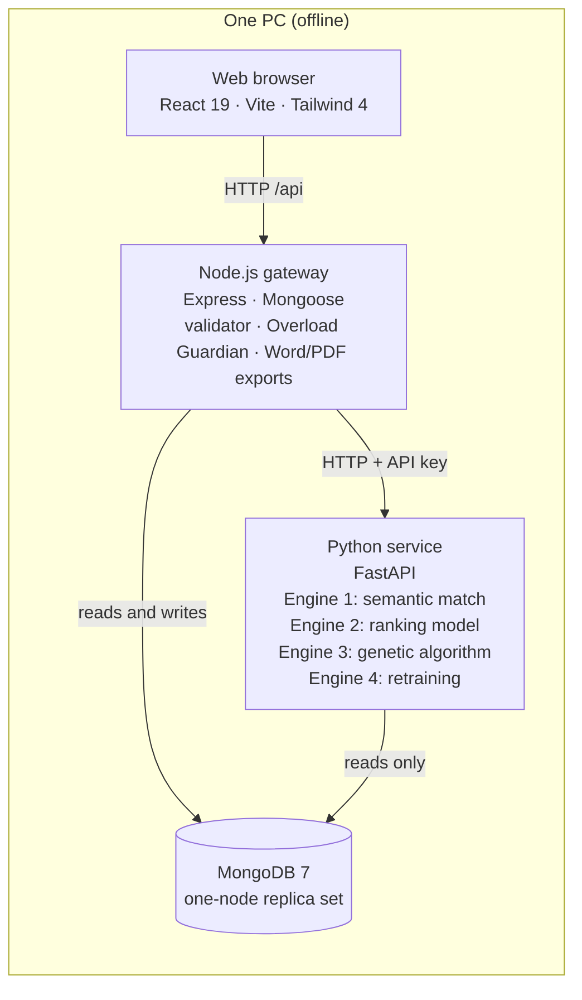

# IntelliSched

IntelliSched is a course scheduling system built as a capstone project for the College of Computer
Studies (CCS) of Laguna State Polytechnic University, Los Baños campus (LSPU-LB), for its BSIT and BSCS
programs. It does two jobs:

1. **Faculty assignment.** For every class (a section and a subject), it ranks the professors who could
   teach it, using a semantic match of their specialization and a machine-learning model trained on past
   Teachers' Programs. An "Overload Guardian" enforces each professor's teaching cap. The Dean decides.
2. **The Mother Schedule.** It builds one weekly timetable per section with a memetic genetic algorithm
   (a GA with repair and local search). No room, professor or section is ever double-booked. Every
   schedule is checked again by an independent validator before it can be approved.

From the same schedule records it prints the office's forms: the Class Schedule per section, the
Teachers' Program (LSPU-ACAD-SF-029) per professor and the Room Schedule per room, as Word and PDF.

Version 1.0.3. **The college's data is not included, for privacy:** this repository holds no real
person's name, no evaluation rating, no secret and no institutional record. The trained recommendation
model and the tests (whose fixtures come from real semesters) are left out for the same reason.

## Architecture

Everything runs on one PC, offline. The browser talks only to the gateway; the gateway is the only
writer to the database.



## Tech stack

| Part | Technology |
| --- | --- |
| Web client | React 19, Vite, Tailwind CSS 4 |
| Gateway | Node.js, Express, Mongoose; Word files written as Office Open XML, PDFs printed with headless Edge or Chrome |
| Python service | FastAPI, NumPy, scikit-learn (monotonic gradient-boosted trees), a memetic genetic algorithm |
| Database | MongoDB 7 (a one-node replica set, for transactions) |
| Deployment | A Windows kit with private runtimes (Node.js, CPython, MongoDB), installed and updated by batch and PowerShell scripts in `IntelliSched/deploy/` |

## Layout

```
IntelliSched/            the web client, the gateway and the shared rules
  client/                React app (port 5173 in development)
  server/                Express gateway (port 5000)
  shared/                the constraint cases both the GA and the validator run
  deploy/                the offline Windows kit (build, install, update, uninstall)
  scripts/               demo, forms, evaluation and manual tools
  docs/evaluation/       the paired t-test results (aggregate statistics only)
intellisched_backend/    the Python service (port 8001)
```

The two folders sit side by side, so the code's relative paths (`../intellisched_backend`) work as they are.

## Running it in development

You need Node.js 24, Python 3.12 and a MongoDB 7 replica set you control, with your own data.

```bash
# 1. the Python service
cd intellisched_backend
python -m venv .venv
.venv/Scripts/pip install -r requirements.txt      # on Windows; .venv/bin/pip elsewhere
.venv/Scripts/pip install numpy==2.5.3
# create .env with MONGO_URI (your database) and the shared API key, then:
.venv/Scripts/python main.py                        # port 8001

# 2. the gateway
cd IntelliSched/server
npm install
cp .env.example .env                                # fill in MONGODB_URI, JWT_SECRET and the API key
npm run dev                                         # port 5000

# 3. the web client
cd IntelliSched/client
npm install
npm run dev                                         # http://localhost:5173
```

The ranking needs a trained model file (`intellisched_gbdt_engine.joblib`), which is not included;
`intellisched_backend/ml/train_eval.py` trains one from your own past semesters.

## Team

The IntelliSched team, capstone project, College of Computer Studies, LSPU Los Baños.

Copyright © 2026 the IntelliSched team. All rights reserved.
